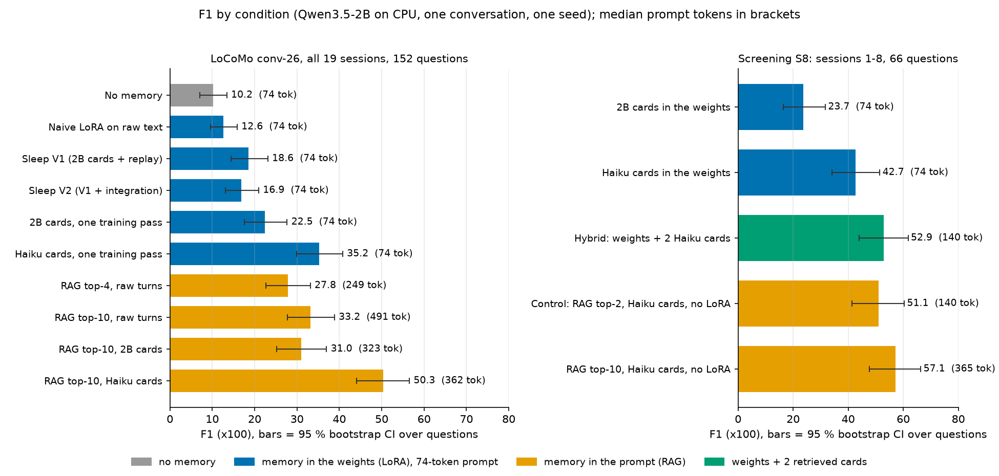
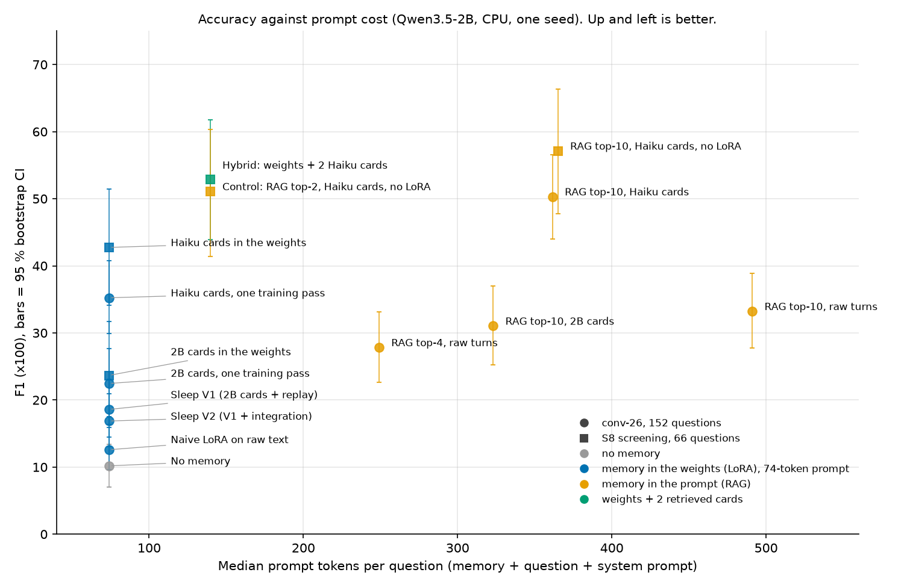

# Hypnos

**Long-term memory for small local language models, consolidated at night: the day's conversation is turned into question-answer cards, and we measure what those cards are worth in the prompt, in a LoRA adapter, or both.**

> Status: research prototype. Every number below comes from **one LoCoMo conversation, one seed, one 2B model on a laptop CPU**.
> Main result so far: **writing good cards is what matters**. The decisive control is done: with 2 retrieved cards, adding the LoRA adapter brings nothing measurable (52.9 against 51.1 F1, paired difference +1.8, 95 % CI −5.0 to +8.7). At this budget the weights are not shown to help. Writing good cards locally is what matters; the LoRA adds nothing measurable at this budget. Read [Limitations](#limitations) before quoting a number.

## The problem

Memory systems for LLM assistants put the memory back into the prompt: they retrieve past messages or notes and prepend them to every question. On a server that is cheap. On a small device, every extra prompt token is prefill time and memory.

Measured here with Qwen3.5-2B on a laptop CPU (median over 152 questions):

| What goes in the prompt | Median prompt tokens | Median prefill |
|---|---|---|
| Question only (no memory) | 74 | 0.35 s |
| RAG, top-4 past turns | 249 | 0.85 s |
| RAG, top-10 past turns | 491 | 1.63 s |

The obvious alternative, fine-tuning the model on the raw conversation, barely works: 12.6 F1 against 10.2 with no memory at all (table below), in line with [Peng (2026)](https://zedongpeng.com/blog/2026/failure-of-parametric-memory), who reports 7.17 against 6.69 with Qwen2.5-1.5B.

Hypnos asks how much of a conversation's memory can be moved into the weights of a small model, and what it costs in accuracy per prompt token saved.

## How it works

```
 DAY (on the device, live)                         NIGHT (on the device, while idle)
 ─────────────────────────                         ──────────────────────────────────
 user ──► small LLM + LoRA adapter ──► answer      1. Write cards: each turn ──► Q/A flashcards
            ▲    prompt = system + question           with absolute dates; cards whose answer
            │    (~74 tokens, no memory)              is not in the turn are dropped
            │                                      2. Replay: 24 older cards + 8 general
            │    hybrid: + 2 cards retrieved          questions (against forgetting)
            │    by embedding (~140 tokens)        3. (V2 only) Integrate: pair new turns with
            │                                         old turns that share a name, write
 turns ──► short-term buffer ─────────────────────►   combined cards
                                                   4. Consolidate: train the LoRA adapter on
            ◄──────────── updated adapter ──────────   the cards, empty the buffer
```

- **Model**: `Qwen/Qwen3.5-2B` in bfloat16 through `transformers`, CPU only.
- **Adapter**: LoRA rank 16, alpha 32, all linear layers, 3 epochs per night, learning rate 2e-4. One adapter accumulates over all nights.
- **Cards**: written by the base model itself (adapter disabled), one prompt per turn. For the diagnostic only, a stronger API model (Claude Haiku 5.5) rewrote the cards of each session, to measure how much card quality limits the method.
- **Sleep V1** = cards + replay. **Sleep V2** = V1 + integration of related memories.
- **Hybrid**: the adapter answers, with the 2 closest cards (all-MiniLM-L6-v2 embeddings) added to the prompt.
- **Evaluation**: [LoCoMo](https://github.com/snap-research/locomo) ([Maharana et al., 2024](https://arxiv.org/abs/2402.17753)). Each session is one day followed by one night; questions are asked after the last night. Official token F1 (Porter-stemmed), adversarial category excluded as in Mem0 and Zep.

## Results

All tables are regenerated from the committed run files by [`docs/figures.py`](docs/figures.py). F1 is ×100. The 95 % interval is a bootstrap over questions. Prompt tokens and prefill times are medians per question; prefill times depend on machine load and are indicative only.



### LoCoMo conv-26: 19 sessions, 152 questions

| Condition | Memory at answer time | F1 | 95 % CI | Prompt tokens | Prefill |
|---|---|---|---|---|---|
| No memory | none | 10.2 | 7.1-13.4 | 74 | 0.35 s |
| Naive LoRA on raw text | weights | 12.6 | 9.6-15.9 | 74 | 0.43 s |
| Sleep V1 (cards + replay) | weights | 18.6 | 14.5-23.1 | 74 | 0.45 s |
| Sleep V2 (V1 + integration) | weights | 16.9 | 13.1-21.0 | 74 | 0.46 s |
| RAG top-4, raw turns | prompt | 27.8 | 22.6-33.2 | 249 | 0.85 s |
| RAG top-10, raw turns | prompt | 33.2 | 27.7-38.9 | 491 | 1.63 s |

With cards written by the 2B model, sleep alone stays far below RAG. A full-context baseline was started and not finished; it will be added.

### Diagnostic: is card quality the bottleneck? (same 152 questions)

| Cards written by | RAG top-10 over the cards | One training pass on all cards, weights only |
|---|---|---|
| Qwen3.5-2B (local) | 31.0 (323 tokens) | 22.5 (74 tokens) |
| Claude Haiku 5.5 (API) | 50.3 (362 tokens) | 35.2 (74 tokens) |

- Same retriever, better cards: +19 F1 (31.0 to 50.3). Card extraction is the main bottleneck, not retrieval and not training.
- With good cards, weights alone (35.2 at 74 tokens) reach the level of RAG top-10 over raw turns (33.2 at 491 tokens).
- Training once on all cards instead of night by night costs little for 2B cards (18.6 nightly, 22.5 in one pass).

### Screening S8: sessions 1-8, 66 questions

| Condition | Memory at answer time | F1 | 95 % CI | Prompt tokens | Prefill |
|---|---|---|---|---|---|
| 2B cards in the weights | weights | 23.7 | 16.4-31.7 | 74 | 0.52 s |
| Haiku cards in the weights | weights | 42.7 | 34.1-51.5 | 74 | 0.48 s |
| **Hybrid: weights + 2 Haiku cards** | weights + 2 cards | **52.9** | 43.9-61.8 | 140 | 0.81 s |
| Control: RAG top-2 on the same cards, no adapter | prompt | 51.1 | 41.4-60.4 | 140 | 0.79 s |
| RAG top-10 on the same cards, no adapter | prompt | 57.1 | 47.8-66.3 | 365 | 1.24 s |

Paired on the same 66 questions:

- the hybrid adds +10.1 F1 to weights alone (95 % CI +5.1 to +15.8);
- **the hybrid against the control (RAG top-2 on the same cards, no adapter): +1.8 F1 (95 % CI −5.0 to +8.7)**, with the same prompt size (140 tokens) and the same prefill (0.81 s against 0.79 s);
- RAG top-10 on the same cards scores +4.3 above the hybrid (95 % CI −2.8 to +11.8), a difference this sample cannot resolve.

Other budgets, same cards, no adapter (`runs/screen/oracle_ragref1_seed0.json`, `oracle_ragref4_seed0.json`; paired intervals from `screen.py compare`): RAG top-1 scores 45.3 F1 (the hybrid is +7.6 above it, 95 % CI −0.7 to +16.0, not established) and RAG top-4 scores 53.0 (hybrid −0.1, 95 % CI −6.9 to +6.7).

**What the control says.** The rule set before the run was: if RAG top-2 without the adapter comes within 2 points of the hybrid, the weights add nothing at this budget. It came within 1.8 points. So on this sample, the gain of the hybrid comes from well-written cards, not from the adapter. What is still open:

- whether the weights are worth a night of training at smaller prompt budgets: weights alone give 42.7 F1 with a 74-token prompt, RAG top-1 gives 45.3 with about 112 tokens (mean), and the hybrid's +7.6 over top-1 is not established;
- whether this holds on other conversations and with more seeds (all 19 sessions of conv-26: see the next section).

### conv-26 complete: 19 sessions, 150 questions

Same cards (Haiku), same 2B reader, same protocol as S8, on every session of conv-26 (`runs/screen/c0s19_oracle_*`).

| Condition | F1 | 95 % CI | Prompt tokens | Prefill |
|---|---|---|---|---|
| Hybrid: weights + 2 Haiku cards | 47.3 | 41.2-53.4 | 138 | 0.80 s |
| Control: RAG top-2, same cards, no adapter | 44.7 | 38.4-51.0 | 138 | 0.78 s |
| RAG top-10, same cards, no adapter | 50.7 | 44.5-56.9 | 362 | 1.26 s |

The hybrid against the control: **+2.6 F1 (paired bootstrap 95 % CI −1.6 to +6.9)**. The rule set in advance was: within 2 points means the weights add nothing; at least +5 with an interval excluding 0 means they earn their place. Neither holds: **not established**. It agrees in sign and size with S8 (+1.8), with a narrower interval. Only multi-hop questions lean towards the adapter (+7.7 on 32 questions, +5.5 on S8). RAG top-10 stays 3.4 above the hybrid (CI −2.0 to +8.8) at 362 tokens instead of 138.

### Writing the cards locally (S8, 66 questions)

The cards are written by `Qwen/Qwen3.5-4B` (Apache-2.0, bf16, CPU, greedy, thinking off, same prompt and same deduplication as for Haiku). The reader is still the 2B without adapter. Table generated by `docs/figures.py`.

| Cards written by | RAG top-2 | RAG top-10 |
|---|---|---|
| Qwen3.5-2B (local) | 27.9 | 37.5 |
| Claude Haiku 5.5 (API) | 51.1 | 57.1 |
| **Qwen3.5-4B (local), v1** | **48.0** | **54.6** |
| Qwen3.5-4B (local), v2: loop guard (`max_new_tokens` 2048, repetition penalty 1.05) | 45.4 | 48.9 |

- Paired on the same 66 questions, top-10: local 4B minus Haiku −2.5 (95 % CI −11.4 to +6.2), local 4B minus 2B cards +17.1 (+8.0 to +26.7). The 4B is not distinguishable from Haiku on this sample and clearly above the 2B.
- The hybrid with the local 4B cards scores **47.7** (134 tokens); the control, RAG top-2 on the same cards without adapter, scores **48.0**: −0.4 (CI −6.3 to +6.7). As with Haiku cards, the adapter adds nothing measurable.
- v2 was tried because one session looped. It is **worse** on top-10 (−5.7, CI −13.9 to +2.0) and top-2 (−2.6, CI −8.8 to +3.4), and writes fewer cards (92 against 109). The rule set before the run (v2 kept only if top-10 ≥ 52.6) was not met, so v1 stays the writer, with `max_new_tokens=2048` as a circuit breaker.

What local writing costs per session (8 sessions of S8, one attempt each, no invalid JSON, peak RAM 9.7 GB):

| | Median wall | Median CPU | Longest session |
|---|---|---|---|
| Qwen3.5-4B v1 | 96 s | 15.7 min | **1,509 s wall, 250.8 min CPU** (looped to 4,096 tokens: 201 raw cards, 29 distinct, 9 of them "Not specified") |
| Qwen3.5-4B v2 | 95 s | 15.6 min | 171 s wall, 28.2 min CPU (479 tokens) |

The degenerate session of v1 (session 8) is kept as it came out, in the v1 numbers above; without it the other seven sessions take 73 to 140 s. This is one writer, one conversation, one seed.

### The trade-off: F1 against prompt tokens



### General skills after 19 nights (ARC-Easy, 200 questions)

| Model | Letter answer | Cloze (likelihood of each option) |
|---|---|---|
| Base model | 89.5 | 72.5 |
| Naive LoRA on raw text | 86.0 | 76.5 |
| Sleep V1 | 87.0 | 79.0 |
| Sleep V2 | 89.0 | 77.5 |

One question is 0.5 point. On this conversation, after 19 nights the two sleep variants lose at most 2.5 points in the letter format (naive LoRA: 3.5) and none in cloze. On the earlier synthetic experiment, one seed out of three lost 16 to 26.5 points in the letter format for reasons not yet established ([details](experiments/001-sleep/README.md#caveats)).

### What a night costs

| | Sleep V1 | Sleep V2 |
|---|---|---|
| CPU time per night, average (card writing + training) | 432 s (7.2 min) | 590 s (9.8 min) |
| Total for 19 nights | 137 min | 187 min |
| Peak RAM during the night | 14-16 GB | 14-17 GB |

Haiku card writing for the diagnostic: 19 API calls, 29,523 input and 40,753 output tokens, USD 0.023 in total.

Against RAG top-10 over raw turns, sleep saves about 1.17 s of prefill per question, so one night pays back its CPU time only beyond roughly **370 questions per session**. In total compute this is not cheaper for normal use. Against RAG over the same well-written cards, the training part of the night has not paid off yet: at 2 cards, the control matches the hybrid with the same prompt and no training. What the night clearly earns is the card writing; whether training on the cards is worth its CPU and RAM on a device is still to be shown.

## Limitations

- **One conversation** (conv-26 of 10), **one seed**, no repeated training runs. The LoRA initialization is not seeded, so re-training gives different numbers.
- **66 questions on S8**: intervals are about ±9 F1 points wide. Only large effects are visible.
- **Local cards were measured on S8 only** (66 questions, one writer run, one seed). The local 4B writer can loop on a session (one of eight did, 25 min of wall time); the loop guard tried so far lowers the score. Not measured on all of conv-26 or on other conversations.
- **The adapter is not shown to help at a 2-card budget**: RAG top-2 on the same cards, without the adapter, is within 1.8 F1 of the hybrid (95 % CI −5.0 to +8.7).
- **Small model, CPU**: one 2B reader on one laptop (Ryzen AI 9 365, 30 GB RAM, no GPU). No phone, console or GPU numbers.
- **Nights are expensive**: about 7 minutes of CPU and 14-16 GB of RAM per night for V1, which only pays off with hundreds of questions per session and is too much RAM for most phones today.
- **No same-writer baselines yet**: Mem0, A-Mem and similar systems have not been run with the same card writer and the same 2B reader.
- **No full-context baseline yet** on LoCoMo.
- **LoCoMo answer key**: a [third-party audit](https://penfieldlabs.substack.com/p/we-audited-locomo-64-of-the-answer) reports 99 wrong answers out of 1,540 (6.4 %); scores on a corrected key are not reported.

## Reproduce

Python 3.12 and [uv](https://docs.astral.sh/uv/). CPU only; the PyTorch CPU wheel is pinned in `pyproject.toml`. The LoCoMo data is downloaded on first use, not redistributed.

```bash
git clone https://github.com/Erazor48/hypnos && cd hypnos
uv sync
uv run --with matplotlib python docs/figures.py           # every table and figure above, from committed runs, no model

cd experiments/001-sleep
uv run python analyze_locomo.py                           # per-category tables from runs/locomo/
uv run python locomo_run.py c0_none --conv 0              # no memory
uv run python locomo_run.py c2_rag --conv 0 --top-k 10    # RAG over raw turns
uv run python locomo_run.py c3_lora_raw --conv 0          # naive LoRA on raw text
uv run python locomo_run.py c4_sleep_replay --conv 0      # sleep V1, about 2.5 h of CPU for 19 nights
uv run python locomo_run.py c5_sleep_integrate --conv 0   # sleep V2
uv run python arc.py adapters/locomo_c4_sleep_replay_conv0        # ARC-Easy, letter
uv run python arc_cloze.py adapters/locomo_c4_sleep_replay_conv0  # ARC-Easy, cloze

# card diagnostic, with the committed Haiku cards (no API key needed)
uv run python diag_cards.py rag --top-k 10 --cards cards_cache/oracle_haiku/all.json --tag oracle
uv run python diag_cards.py onepass --cards cards_cache/oracle_haiku/all.json --tag oracle

# S8 screening (needs the state of a finished c4_sleep_replay run, adapters/ is not committed)
uv run python screen.py run baseline
uv run python screen.py run oracle --cards oracle_haiku --hybrid-top-k 2 --rag-ref 10
uv run python screen.py rag --cards oracle_haiku --top-k 1 2 4   # the control: RAG top-1/2/4 on the same cards, no adapter
uv run python screen.py compare oracle_ragref2 oracle_hybrid2   # paired difference, hybrid minus control
```

`./run_locomo.sh 0` runs the LoCoMo batch for one conversation and resumes where it stopped. Regenerating the Haiku cards (`oracle_cards.py`) needs an Anthropic API key and is not required to reproduce the tables. The first experiment, on a synthetic world with three seeds, is documented in [experiments/001-sleep](experiments/001-sleep/README.md).

## Roadmap

1. **Control** (done on S8 and on all of conv-26): RAG top-2 on the same cards without the adapter matches the hybrid on S8 (+1.8) and is not separated from it on conv-26 (+2.6, not established). Next: smaller prompt budgets and other conversations.
2. **Local card writer**: first result done on S8 with `Qwen/Qwen3.5-4B` (Apache-2.0, open weights) while the 2B stays the reader. Next: other conversations. Claude outputs are used as a diagnostic only and will not be used to train a card writer.
3. **All 10 LoCoMo conversations, 3 seeds**, paired bootstrap tests, a full-context baseline with measured prefill, and scores on a corrected answer key.
4. **Same-writer baselines**: Mem0 and A-Mem with the same card writer and the same 2B reader, with their full write and read costs.
5. **Variants**: one LoRA per session chosen by embedding; consolidation by context distillation instead of training on cards; full instead of diluted replay.
6. **Reader sizes** 0.8B, 2B and 4B, and a CPU-sized subset of LongMemEval.
7. **Demo**: a local game character that remembers across nights.

## Using this? Tell us your use case

If you need memory for a small or on-device model (game characters, assistants, apps, robots), [open a use-case issue](https://github.com/Erazor48/hypnos/issues/new?template=use-case.yml). It asks what you build, which model size you run, how you handle memory today, how many prompt tokens memory costs you and what breaks. A short optional section asks about price. The issue is public: do not paste confidential data.

## License

Code: [Apache License 2.0](LICENSE).

Data: files derived from LoCoMo (`experiments/001-sleep/cards_cache/`, `experiments/001-sleep/runs/locomo/`, `experiments/001-sleep/runs/screen/`) quote its questions and answers and stay under [CC BY-NC 4.0](https://creativecommons.org/licenses/by-nc/4.0/), like [LoCoMo itself](https://github.com/snap-research/locomo): attribution required, no commercial use. The cards in `cards_cache/oracle_haiku/` were written by Claude Haiku 5.5 and are kept as a research diagnostic only.

Copyright 2026 Ethan Orain.

## Citation

```bibtex
@software{hypnos2026,
  author = {Orain, Ethan},
  title  = {Hypnos: nightly memory consolidation for small local language models},
  year   = {2026},
  url    = {https://github.com/Erazor48/hypnos}
}
```

Please also cite LoCoMo:

```bibtex
@article{maharana2024locomo,
  author  = {Maharana, Adyasha and Lee, Dong-Ho and Tulyakov, Sergey and Bansal, Mohit and Barbieri, Francesco and Fang, Yuwei},
  title   = {Evaluating Very Long-Term Conversational Memory of LLM Agents},
  journal = {arXiv preprint arXiv:2402.17753},
  year    = {2024}
}
```
